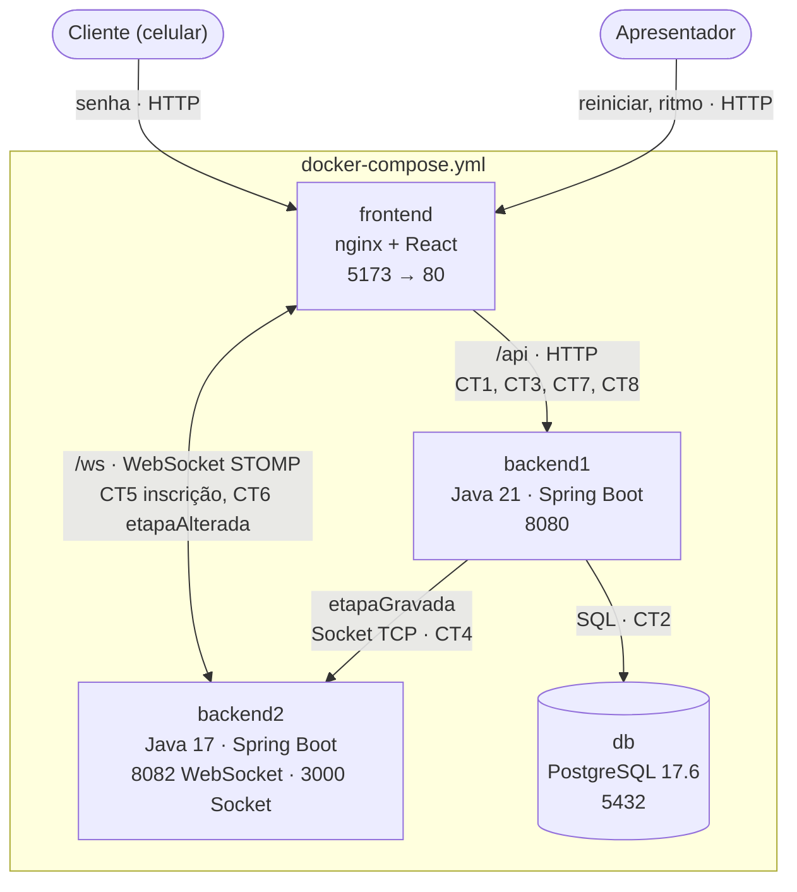
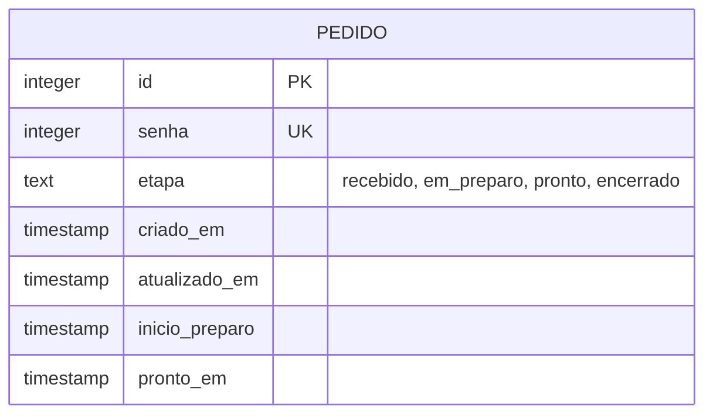
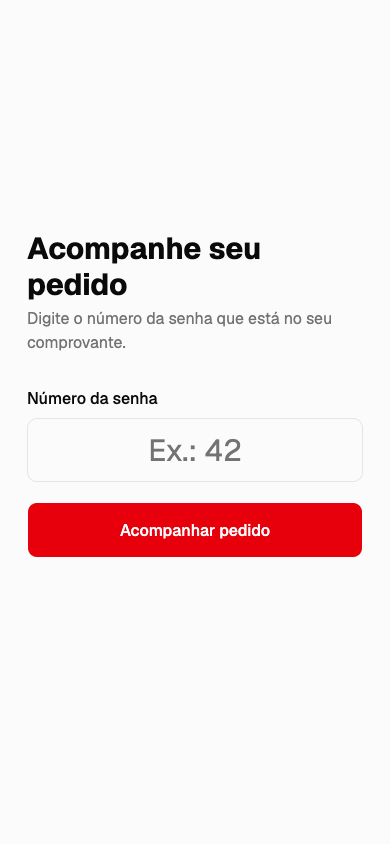
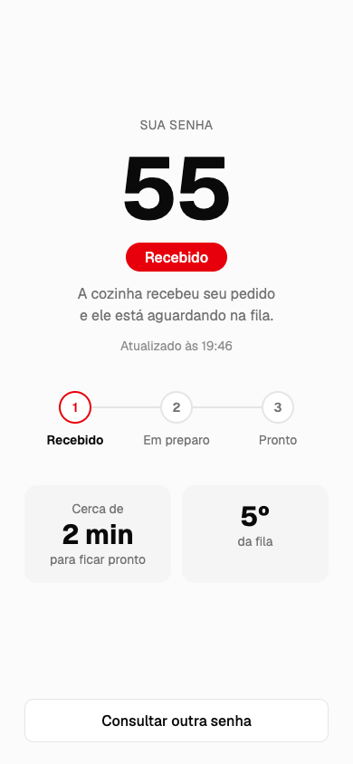
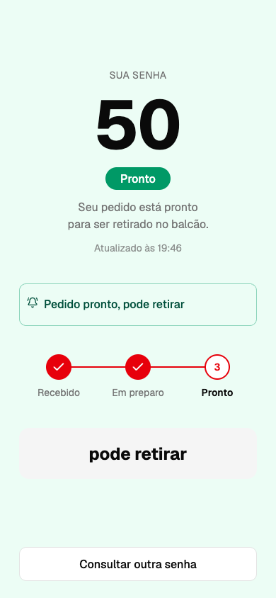
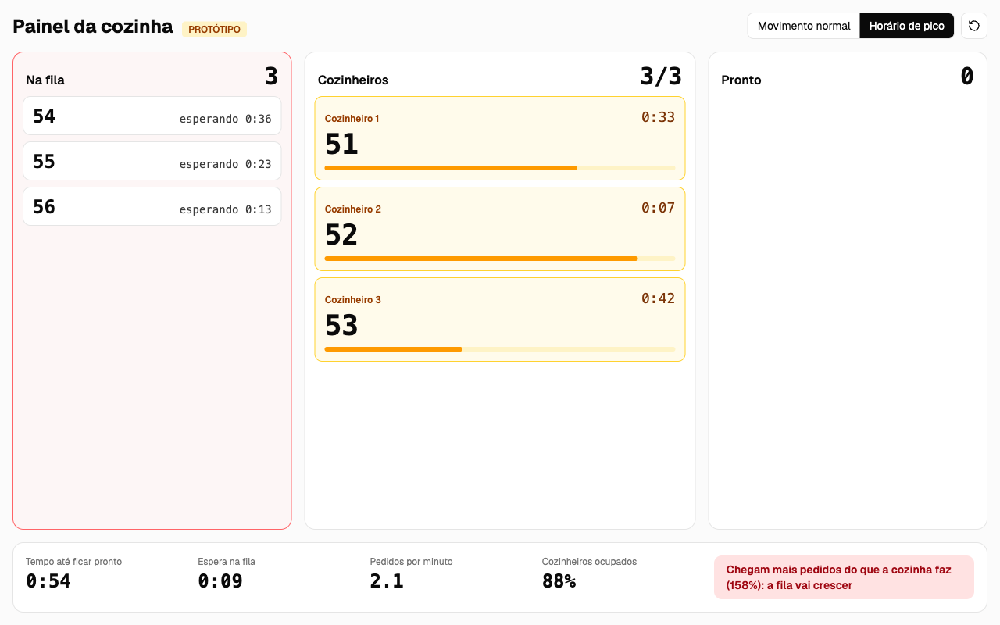

# Documento de Projeto: Sistema de Gestão de Filas

Projeto Integrador IV · PUC-Campinas · Sistemas de Informação · Turma 0102 · Grupo 06 · 2026-2

Versão entregue: [v1.0](https://github.com/pedromeira220/pi4-2026-2-0102-grupo06/releases/tag/v1.0) · Revisado em 23/11/2026 · O capítulo 9 é o [README.md](../README.md) da raiz.

---

## 1. Visão geral

**Responsável:** Pedro Henrique Meira

**Problema.** Em praça de alimentação, quem pede no balcão não sabe quanto falta para o pedido ficar pronto. Pager, painel de senha e chamada por voz só avisam o "pronto" e não mostram o andamento. Por isso o cliente espera em pé perto do balcão e interrompe o atendente para perguntar. O dado do andamento existe na cozinha, mas não chega a quem espera, e um kit de pager custa de R$ 792 a R$ 1.246 para dar só o aviso final.

**Público.**

- **Cliente:** fez o pedido e quer ver no celular, sem cadastro, a etapa e quanto falta.
- **Apresentador:** demonstra o sistema, reinicia a fila e alterna o ritmo de movimento no painel da cozinha.

**Escopo.**

- **E1** O cliente digita a senha e vê o próprio pedido.
- **E2** A fila de demonstração anda sozinha.
- **E3** A tela se atualiza sozinha quando a etapa muda.
- **E4** A tela mostra a estimativa em minutos, a posição na fila e a barra das etapas.
- **E5** Quando fica pronto, a tela muda de cor e avisa "pode retirar".
- **E6** O sistema sobe com `docker compose up`.

Além dos entregáveis, entrou em novembro um protótipo do painel da cozinha (`/prototipo-fluxo`), que só mostra a fila e serve para apresentar o sistema a donos de restaurante.

**Fora do escopo.** O painel em que o funcionário cria e avança pedidos à mão (os pedidos vêm do simulador), login e cadastro, integração com PDV e nota fiscal, e o QR code impresso previsto no E1 e no E6, cortado nesta versão.

## 2. Objetivos

**Responsável:** Pedro Henrique Meira

**Objetivo geral.** Construir uma aplicação web de acompanhamento de pedidos para praças de alimentação, aberta no celular e sem cadastro, que mostre a etapa e a estimativa de tempo do pedido e se atualize sozinha.

**Objetivos específicos.**

- **OE1** Representar o ciclo de vida do pedido e alimentá-lo automaticamente para a demonstração (E2).
- **OE2** Mostrar ao cliente, sem aplicativo e sem cadastro, a etapa, a estimativa e a posição na fila (E1, E4).
- **OE3** Atualizar a página em até 10 s e sinalizar o pedido pronto (E3, E5).
- **OE4** Subir o sistema com um comando em qualquer máquina com Docker (E6).

## 3. Requisitos

**Responsável:** João Pedro Júlio

### 3.1 Requisitos funcionais

A Entrega 1 não deu prioridade aos E. Nesta entrega, o que o critério de sucesso cobra ficou Alta, e o E2, que só serve à demonstração, ficou Média. Nenhum E foi cortado ou renumerado.

| ID | Prioridade | Feito quando (critério de aceite) | Situação | Fluxo · Contratos |
|---|---|---|---|---|
| E1 Chegada ao pedido pela senha | Alta | O cliente digita "42" e vê a senha e a etapa por extenso. Senha inexistente mostra "Pedido não encontrado, confira o número na sua senha". | Parcial: sem o QR impresso | [E1](https://github.com/pedromeira220/pi4-0102-g6-frontend/blob/main/docs/fluxos/E1-chegada-ao-pedido-pela-senha.md) · CT1, CT2 |
| E2 Fila de demonstração | Média | Sem ninguém mexendo, entra um pedido a cada 20 a 30 s e os existentes avançam até "Encerrado". "Reiniciar demo" esvazia a fila. | Pronto, alterado: era "a cada 30 s" ([ADR 0002](https://github.com/pedromeira220/pi4-0102-g6-backend-1/blob/main/docs/adr/0002-simular-a-cozinha-por-cozinheiros.md)) | [E2](https://github.com/pedromeira220/pi4-0102-g6-frontend/blob/main/docs/fluxos/E2-fila-de-demonstracao.md) · CT2, CT3, CT8 |
| E3 A tela se atualiza sozinha | Alta | Com a tela aberta e sem tocar em nada, a etapa muda em até 10 s depois que a fila avança o pedido. | Pronto | [E3](https://github.com/pedromeira220/pi4-0102-g6-frontend/blob/main/docs/fluxos/E3-tela-se-atualiza-sozinha.md) · CT4, CT5, CT6 |
| E4 Quanto falta na tela | Alta | A tela mostra "Cerca de N min", a posição na fila e a barra com a etapa atual destacada. Em "Pronto", mostra "pode retirar". | Pronto, com a posição na fila acrescentada em outubro | [E4](https://github.com/pedromeira220/pi4-0102-g6-frontend/blob/main/docs/fluxos/E4-quanto-falta-na-tela.md) · CT1, CT2, CT4, CT6 |
| E5 Aviso de pronto | Alta | Em "Pronto", a tela muda de cor e mostra "Pedido pronto, pode retirar" até o pedido ser encerrado. | Pronto | [E5](https://github.com/pedromeira220/pi4-0102-g6-frontend/blob/main/docs/fluxos/E5-aviso-de-pronto.md) · CT4, CT6 |
| E6 Sistema empacotado | Alta | Num clone limpo, `docker compose up --build` sobe o sistema e quem nunca viu o projeto chega à tela em menos de 5 min seguindo o README. | Parcial: sem QR de teste | [E6](https://github.com/pedromeira220/pi4-0102-g6-frontend/blob/main/docs/fluxos/E6-sistema-empacotado.md) · todos |

### 3.2 Requisitos não funcionais

| ID | Requisito | Teste |
|---|---|---|
| RNF-01 | **Um comando.** Num clone limpo, com só Git e Docker, `docker compose up --build` sobe os quatro serviços sem passo manual. | TE-11 |
| RNF-02 | **Queda do Backend 2.** O Backend 1 continua respondendo e gravando, registra o aviso no log e reconecta sozinho quando o Backend 2 volta. | TE-12 |
| RNF-03 | **Reconexão da página.** Se o WebSocket cai, a página reconecta e volta a receber as mudanças sem recarregar. | TE-13 |
| RNF-04 | **Desempenho.** A mudança de etapa aparece na tela em até 10 s depois de gravada. | TE-14 |
| RNF-05 | **Senhas e chaves.** A senha do banco vem de variável de ambiente, o `.env` não vai para o Git e o banco só é publicado em `127.0.0.1`. | TE-15 |
| RNF-06 | **Dados pessoais.** O sistema guarda só senha, etapa e horários: nenhum nome, telefone, e-mail ou login, então não há dado sujeito à LGPD. | TE-16 |
| RNF-07 | **Celular.** A página funciona com 375 px de largura, sem rolagem horizontal. | TE-17 |

### 3.3 Rastreabilidade

| Requisito | Fluxo | Contratos | Testes |
|---|---|---|---|
| E1 | E1 | CT1, CT2 | TE-01, TE-02, TE-03, TE-24 |
| E2 | E2 | CT2, CT3, CT8 | TE-04, TE-05, TE-18, TE-21 |
| E3 | E3 | CT4, CT5, CT6 | TE-06, TE-25, TE-26, TE-27 |
| E4 | E4 | CT1, CT2, CT4, CT6 | TE-07, TE-22, TE-23 |
| E5 | E5 | CT4, CT6 | TE-08, TE-09, TE-10 |
| E6, RNF-01 | E6 | todos | TE-11 |
| RNF-02 a RNF-04 | E3 | CT4, CT5, CT6 | TE-12, TE-13, TE-14, TE-25 |
| RNF-05 a RNF-07 | E1, E4, E6 | CT2 | TE-15, TE-16, TE-17 |
| Painel da cozinha | — | CT7, CT8 | TE-19 |

## 4. Arquitetura

**Responsável:** Patrick Eduardo Pereira de Oliveira

### 4.1 Visão da arquitetura

Quatro serviços, um contêiner cada. O **frontend** (nginx) serve a página React e repassa `/api` ao backend1 e `/ws` ao backend2, então o celular só conhece um endereço. O **backend1** responde às consultas, roda o simulador da cozinha e grava no **db**. A cada mudança de etapa, ele avisa o **backend2** por Socket TCP, que repassa a etapa às páginas por WebSocket.

### 4.2 Implantação com Docker

| Serviço | Imagem | Porta | Publicada ou interna | Depende de |
|---|---|---|---|---|
| db | `postgres:17.6-alpine` | 5432 | Publicada só em `127.0.0.1` | — |
| backend2 | build de `pi4-0102-g6-backend-2` (Temurin 17) | 8082 e 3000 | 8082 publicada; 3000 interna | — |
| backend1 | build de `pi4-0102-g6-backend-1` (Temurin 21) | 8080 | Publicada | db saudável, backend2 |
| frontend | build de `pi4-0102-g6-frontend` (Node 22 + nginx) | 80 | Publicada como 5173 | backend1, backend2 |

O banco é criado na primeira subida pelos scripts `db/init` do Backend 1 e guardado no volume `pgdata`.

### 4.3 Comunicação por socket

O **Backend 2 é o servidor**, na porta 3000 (interna); o **Backend 1 é o cliente** e mantém uma conexão aberta, reaproveitada para todos os avisos. Cada mensagem é um objeto Java serializado `EtapaGravada`, subclasse de `Comunicado`, com `senha`, `etapa`, `estimativaMinutos`, `posicaoNaFila` e `atualizadoEm`, no molde do Fazedor de Continhas. O formato está na ficha [CT4](https://github.com/pedromeira220/pi4-0102-g6-backend-1/blob/main/docs/contratos/CT4-etapaGravada.md).

**Quando a conexão cai**, o Backend 1 fecha a conexão, registra "Backend 2 indisponivel" no log e segue: a etapa já está gravada no banco, então a consulta da página continua certa. Na mudança seguinte, ele reconecta. A página, por sua vez, reconecta o WebSocket e busca a etapa atual (CT5). Os dois casos foram testados (TE-12 e TE-13).

### 4.4 Tecnologias

| Camada | Tecnologia | Por que |
|---|---|---|
| Página | React 18.3, TypeScript, Vite 5.4, Tailwind 4 | Componentes reaproveitáveis e build estático servido pelo nginx |
| Tempo real na página | `@stomp/stompjs` 7.5 | Reconexão automática, que cumpre o RNF-03 |
| Servidor da página | nginx | Serve o build e faz o proxy de `/api` e `/ws` |
| Backend 1 | Java 21, Spring Boot 4.1.2, JPA | Linguagem do curso; `@Scheduled` roda o simulador |
| Backend 2 | Java 17, Spring Boot 3.5.16, `java.net.Socket` | WebSocket empurra a etapa à página; Socket é o pedido da disciplina entre backends |
| Banco | PostgreSQL 17.6 | Dados persistem no reinício; modelo relacional fixo |
| Testes e CI | JUnit 5, GitHub Actions | Roda a cada push nos dois backends |
| Empacotamento | Docker Compose | Um comando sobe tudo (E6) |

## 5. Banco de dados

**Responsável:** Pedro Henrique Meira

Conferido contra o `db/init/01-schema.sql` que o Compose executa.

**pedido** guarda cada pedido da fila: a senha que o cliente digita, a etapa e os horários que o simulador usa. É a única tabela, então não há chave estrangeira nem cardinalidade. A estimativa e a posição na fila são calculadas na consulta, sem coluna. Detalhe campo a campo na ficha [CT2](https://github.com/pedromeira220/pi4-0102-g6-backend-1/blob/main/docs/contratos/CT2-pedido.md).

## 6. Contratos e decisões

**Responsável:** Murilo Ferrez dos Santos

| ID | Nome | Fronteira | Ficha |
|---|---|---|---|
| CT1 | consultarPedido | HTTP, Frontend → Backend 1 | [CT1](https://github.com/pedromeira220/pi4-0102-g6-backend-1/blob/main/docs/contratos/CT1-consultarPedido.md) |
| CT2 | pedido | Banco | [CT2](https://github.com/pedromeira220/pi4-0102-g6-backend-1/blob/main/docs/contratos/CT2-pedido.md) (atualizada) |
| CT3 | reiniciarDemo | HTTP, Frontend → Backend 1 | [CT3](https://github.com/pedromeira220/pi4-0102-g6-backend-1/blob/main/docs/contratos/CT3-reiniciarDemo.md) |
| CT4 | etapaGravada | Socket TCP, Backend 1 → Backend 2 | [CT4](https://github.com/pedromeira220/pi4-0102-g6-backend-1/blob/main/docs/contratos/CT4-etapaGravada.md) |
| CT5 | acompanharPedido | WebSocket, Frontend → Backend 2 | [CT5](https://github.com/pedromeira220/pi4-0102-g6-backend-2/blob/main/docs/contratos/CT5-acompanharPedido.md) |
| CT6 | etapaAlterada | WebSocket, Backend 2 → Frontend | [CT6](https://github.com/pedromeira220/pi4-0102-g6-backend-2/blob/main/docs/contratos/CT6-etapaAlterada.md) (atualizada) |
| CT7 | painel | HTTP, Frontend → Backend 1 | [CT7](https://github.com/pedromeira220/pi4-0102-g6-backend-1/blob/main/docs/contratos/CT7-painel.md) (nova) |
| CT8 | mudarRitmo | HTTP, Frontend → Backend 1 | [CT8](https://github.com/pedromeira220/pi4-0102-g6-backend-1/blob/main/docs/contratos/CT8-mudarRitmo.md) (nova) |

| ADR | Título | Status |
|---|---|---|
| [Backend 1 · 0001](https://github.com/pedromeira220/pi4-0102-g6-backend-1/blob/main/docs/adr/0001-usar-postgresql-como-banco.md) | Usar PostgreSQL como banco | Aceito |
| [Backend 1 · 0002](https://github.com/pedromeira220/pi4-0102-g6-backend-1/blob/main/docs/adr/0002-simular-a-cozinha-por-cozinheiros.md) | Simular a cozinha por cozinheiros, com chegadas sorteadas | Aceito (novo) |
| [Backend 2 · 0001](https://github.com/pedromeira220/pi4-0102-g6-backend-2/blob/main/docs/adr/0001-empurrar-o-status-por-websocket-com-stomp.md) | Empurrar o status por WebSocket com STOMP | Aceito |

Os fluxos ficam em [`docs/fluxos/`](https://github.com/pedromeira220/pi4-0102-g6-frontend/tree/main/docs/fluxos) do Frontend.

## 7. Testes

**Responsáveis:** Murilo Ferrez dos Santos e João Pedro Júlio

### 7.1 Estratégia

Cada backend tem testes JUnit que rodam no GitHub Actions a cada push. No Backend 1, o CI sobe um PostgreSQL com os mesmos scripts do Compose. O que só aparece com os contêineres juntos foi testado à mão, com o sistema no ar pelo Compose, no Chrome do macOS em 390 px e 1280 px de largura, por Pedro Henrique Meira em 23/11/2026. O grupo não configurou SonarQube.

### 7.2 Testes automatizados

| Backend | JUnit | Último CI | SonarQube |
|---|---|---|---|
| Backend 1 | 44 testes | [run 44635737710](https://github.com/pedromeira220/pi4-0102-g6-backend-1/actions/runs/44635737710), sucesso | Não configurado |
| Backend 2 | 8 testes | [run 44635741196](https://github.com/pedromeira220/pi4-0102-g6-backend-2/actions/runs/44635741196), sucesso | Não configurado |

### 7.3 Casos de teste

| ID | Verifica | Passos | Esperado | Obtido | Situação |
|---|---|---|---|---|---|
| TE-01 | E1 | Digitar uma senha existente | Senha e etapa por extenso | Senha 55, "Recebido" | Passou |
| TE-02 | E1 (erro) | Abrir `/order/9999` | "Pedido não encontrado…" | Mensagem exibida | Passou |
| TE-03 | CT1 (erro) | `GET /pedidos/abc` | 400 `SENHA_INVALIDA` | 400 `SENHA_INVALIDA` | Passou |
| TE-04 | E2 | Deixar o sistema 4 min sem tocar | Pedidos chegam e vão até encerrado | Senhas 1 a 8 encerradas | Passou |
| TE-05 | E2, CT3 | `POST /demo/reiniciar` | Fila vazia, senha recomeça em 1 | 0 pedidos, depois senhas 1 e 2 | Passou |
| TE-06 | E3 | Tela aberta em preparo, sem tocar | Muda sozinha para Pronto | Mudou sem recarregar | Passou |
| TE-07 | E4 | Abrir senha em Recebido | Minutos, posição e barra | "Cerca de 2 min", "5º da fila" | Passou |
| TE-08 | E4 | Abrir senha em Pronto | "pode retirar" sem minutos | Como esperado | Passou |
| TE-09 | E5 | Esperar o pedido ficar pronto | Tela verde com o aviso | Como esperado | Passou |
| TE-10 | E5 | Manter a tela depois do pronto | Aviso até o encerramento | Visível por 15 s, depois "encerrado" | Passou |
| TE-11 | E6, RNF-01 | Clonar do zero e subir pelo README | Sobe sem passo manual | Rodado só na cópia do grupo | Não executado |
| TE-12 | RNF-02 | Parar e subir o backend2 | Backend 1 responde e reconecta | 200; log do aviso; reconectou | Passou |
| TE-13 | RNF-03 | Parar o backend2 com a tela aberta | Página reconecta sozinha | Recebeu o Pronto depois da volta | Passou |
| TE-14 | RNF-04 | Comparar `prontoEm` com a tela | Até 10 s | 0,3 s | Passou |
| TE-15 | RNF-05 | Ler código, `.gitignore` e Compose | Sem senha no código | Conforme o RNF | Passou |
| TE-16 | RNF-06 | Ler `01-schema.sql` | Sem dado pessoal | Só senha, etapa e horários | Passou |
| TE-17 | RNF-07 | Abrir em 375 px | Sem rolagem horizontal | Largura igual à tela | Passou |
| TE-18 | CT8 (erro) | `POST /demo/ritmo/xyz` | 400 `RITMO_INVALIDO` | 400 `RITMO_INVALIDO` | Passou |
| TE-19 | CT7, CT8 | Abrir o painel e ligar o pico | Fila cresce | Senha 57 em 6º da fila | Passou |
| TE-20 | E2 | Ler o texto de `/demo` | Descreve a regra atual | Diz "a cada 30 segundos" | Falhou (D-01) |

Os testes JUnit entram na rastreabilidade agrupados por classe: **TE-21** `SimuladorDaFilaTest` (E2, 11 testes), **TE-22** `EstimativaDeEsperaTest` (E4, 9), **TE-23** `PosicaoNaFilaTest` (E4, 5), **TE-24** `PedidoContratoTest` (E1, CT1, CT2, 13), **TE-25** `ApertoDeMaoBackend2Test` (CT4, RNF-02, 5), **TE-26** `ApertoDeMaoComBackend1Test` (CT4, CT6, 7) e **TE-27** `NotificacaoServiceTest` (CT6, 1). Somados ao `contextLoads`, são 52.

### 7.4 Resumo da execução

Rodada manual de 23/11/2026: 20 casos, 19 executados, 18 passaram, 1 falhou e 1 não foi executado. Os 52 testes JUnit passaram no CI de 19/11/2026.

### 7.5 Defeitos conhecidos

O grupo não abriu cards de defeito no OpenProject.

| ID | Defeito | Severidade | Teste | Card |
|---|---|---|---|---|
| D-01 | A página `/demo` ainda diz "A cada 30 segundos entra um pedido novo", regra substituída pelo ADR 0002 | Baixa | TE-20 | Sem card |

## 8. Principais telas

**Responsável:** Neilton de Lima Tavarez

Prints da versão entregue, de 23/11/2026.

| Senha (`/`) | Recebido | Pronto |
|---|---|---|
|  |  |  |
| O cliente digita a senha do comprovante. Senha inexistente mostra "Pedido não encontrado" (E1). | Senha, etapa, barra das etapas, estimativa e posição na fila. Muda sozinha (E1, E3, E4). | Tela verde com "Pedido pronto, pode retirar" até o encerramento (E5). |

**Painel da cozinha (`/prototipo-fluxo`).** Protótipo para donos de restaurante: mostra a fila, o que cada um dos três cozinheiros prepara e os prontos, e alterna entre movimento normal e pico (CT7, CT8). A página `/demo`, com o botão "Reiniciar demo" (E2), é usada só pelo apresentador.

## 9. Como rodar

<!-- README -->

## 10. Conclusão

**Responsável:** Pedro Henrique Meira

O sistema cumpre o critério de sucesso da Entrega 1: o cliente digita a senha no celular, sem cadastro, e vê o pedido passar por recebido, em preparo e pronto, com cada mudança chegando à tela em menos de um segundo. Ficou de fora o QR code impresso.

**Deu certo** escrever os contratos antes do código. Com o CT4 fechado, os dois backends foram feitos em paralelo, e a tabela de erros de cada ficha virou caso de teste.

**Deu trabalho** o Socket com objetos serializados: a classe `EtapaGravada` precisa ser idêntica nos dois backends, e uma diferença só aparece quando a mensagem chega. O simulador também foi refeito, porque o ciclo fixo de 30 s deixava a estimativa e a posição sempre iguais (ADR 0002). No processo, faltaram os cards de defeito e o SonarQube.

**Para a próxima versão:** o QR code, o painel do atendente no lugar do simulador, itens reais no pedido e SonarQube no CI.

## 11. Anexos

**Responsável:** Pedro Henrique Meira

- Repositório principal: https://github.com/pedromeira220/pi4-2026-2-0102-grupo06
- Backend 1: https://github.com/pedromeira220/pi4-0102-g6-backend-1
- Backend 2: https://github.com/pedromeira220/pi4-0102-g6-backend-2
- Frontend: https://github.com/pedromeira220/pi4-0102-g6-frontend
- Quadro no OpenProject: https://srv1889234.hstgr.cloud/projects/pi-iv-0102-g6/work_packages
- Release v1.0: https://github.com/pedromeira220/pi4-2026-2-0102-grupo06/releases/tag/v1.0
- CI do Backend 1: https://github.com/pedromeira220/pi4-0102-g6-backend-1/actions/runs/44635737710
- CI do Backend 2: https://github.com/pedromeira220/pi4-0102-g6-backend-2/actions/runs/44635741196
- SonarQube: não configurado.
